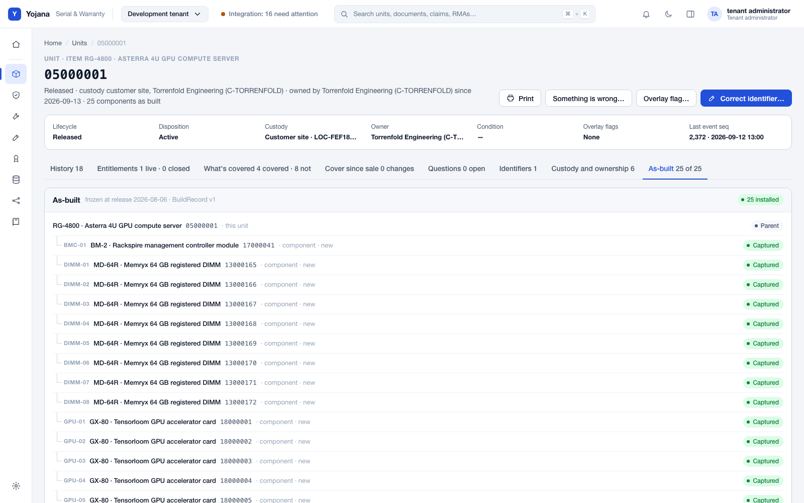
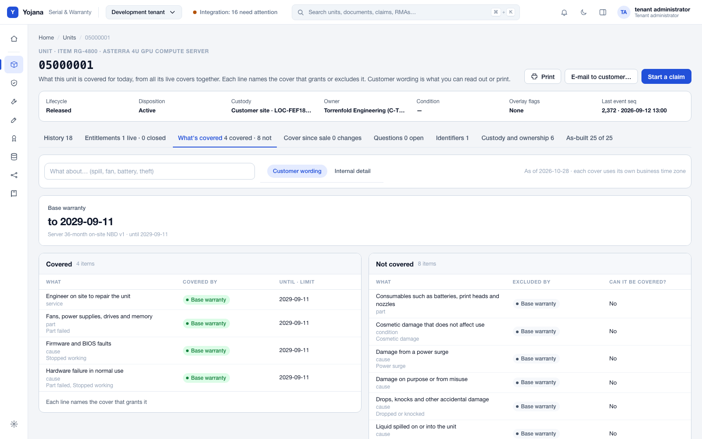
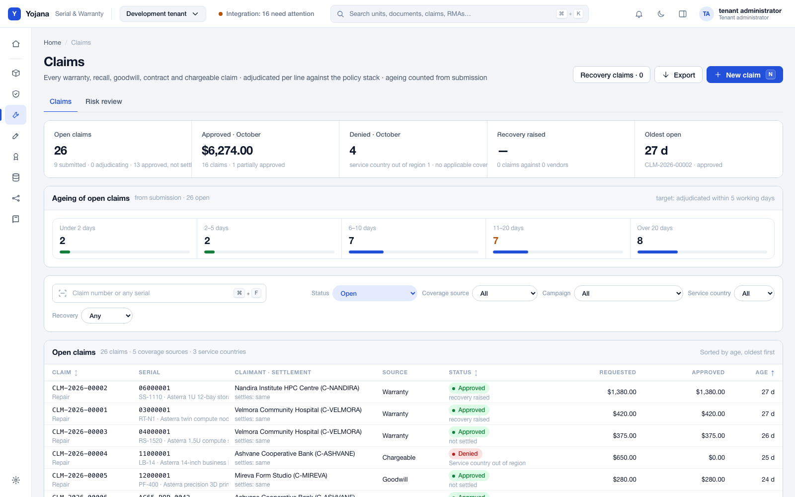
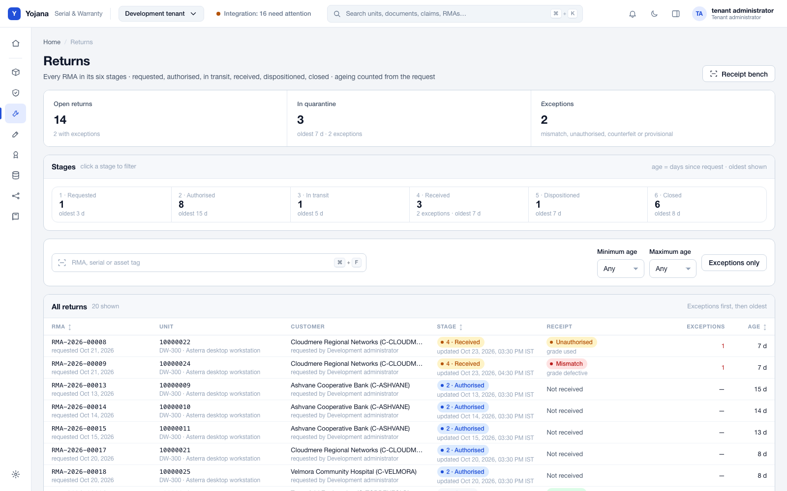

<div align="center">

# Yojana

**Open-source serial-number and warranty management for companies that build, sell and service hardware.**

Every unit, every part inside it, every warranty — traced from goods receipt to production, delivery, service and return.

[](LICENSE)


<picture><source media="(prefers-color-scheme: dark)" srcset=".github/assets/asbuilt-dark.png"></picture>

</div>

---

## Why Yojana

ERP serial fields tell you *that* a serial was received or shipped. They rarely tell you what is **inside** a server,
which **warranty** covers it today, who **had** it last month, or what happened when a part was swapped in the field.
Yojana keeps that history as an append-only ledger beside your ERP, so service, quality and finance all see the same
facts.

## What it does

| | |
|---|---|
| 🔢 **Unit identity & custody** | One record per physical unit: manufacturer, vendor and internal serials, MAC, IMEI, GS1 (SGTIN, GIAI) and UDI identifiers; location and owner over time; scan-first screens. |
| 🧩 **As-built records** | Components issued in the ERP become the parent's as-built tree automatically; returns and swaps keep the history. |
| 🛡️ **Warranty & entitlements** | Policy engine for standard and extended cover, add-ons and contract terms; "is this unit covered?" answered in milliseconds. |
| 🔧 **Claims, RMA & refurbishment** | Claims, campaigns and supplier recovery; returns, replacements and refurbish-to-stock with a full trail. |
| ✍️ **Corrections with approval** | Mistakes are corrected, never edited away: every fix is an event with a reason, an approver and an audit trail. |
| 🏷️ **Certificates & labels** | Warranty certificates as PDF and serial labels on plain laser-printer label sheets. |
| 🔌 **ERP integration** | An ERP-agnostic gateway with connectors; a relay for on-premises ERPs; the ERP stays the system of record for stock. |
| 🌐 **Customer portal, API & webhooks** | Customers register products and raise returns; developers get a public API and signed webhooks. |
| 📦 **Imports & legacy migration** | Spreadsheet imports and a rehearsed, reversible cut-over from a legacy serial system. |
| 🔐 **Built for business data** | Multi-company with row-level security, passkeys and TOTP, role-based approvals, privacy erasure, no PII in logs. |

<table>
<tr>
<td width="33%"><picture><source media="(prefers-color-scheme: dark)" srcset=".github/assets/coverage-dark.png"></picture><br><sub><b>What's covered</b>: one answer from every live cover, in customer wording</sub></td>
<td width="33%"><picture><source media="(prefers-color-scheme: dark)" srcset=".github/assets/claims-dark.png"></picture><br><sub><b>Claims</b>: adjudicated per line, aged from submission</sub></td>
<td width="33%"><picture><source media="(prefers-color-scheme: dark)" srcset=".github/assets/returns-dark.png"></picture><br><sub><b>Returns</b>: every RMA through six stages, exceptions first</sub></td>
</tr>
</table>

<sub>Screenshots show the fictional companies and products from the project's demo loader (`make demo`).</sub>

## Measured, not promised

| Workload | Result | Where measured |
|---|---|---|
| Goods receipt of **10,000 serials** | **3.17 s** (warm) | Benchmark host, SQL Server 2025 Developer |
| Shipment of 500 serials | 431 ms database time | Same host |
| Warranty entitlement check | **p99 10.7–11.5 ms** | Same host |
| Legacy migration rehearsal, **150,000 serials** | cut-over 24.6 min, full undo 26 min | Same host |

Figures are from the project's own phase benchmarks on a single developer-class Windows machine; your hardware will differ.

## Quick start

Prerequisites: .NET SDK 10, Node.js 22+, Docker, GNU make.

```bash
git clone https://github.com/isureshsubramanian/Yojana.git && cd Yojana
make env restore web-install web   # generated dev passwords, packages, web client
make db-up db-wait seed            # SQL Server in Docker, demo tenant with one user per role
make run                           # open http://localhost:5080
```

Sign in as `admin@dev.yojana.local` with the `YOJANA_SEED_PASSWORD` written to `.env`. Full developer guide:
[DEVELOPING.md](DEVELOPING.md).

## Architecture at a glance

```
 ERP (on-premises or cloud)                      People
        │  API or database                         │  browser, scanner, portal
   ┌────▼─────┐   signed, pinned    ┌──────────────▼──────────────┐
   │  Relay   │ ──────────────────► │  Yojana host (.NET 10)       │
   └──────────┘                     │  Integration · Serialisation │──► Webhooks / public API
                                    │  Knowledge · Developer       │
                                    └──────────────┬──────────────┘
                                                   │ outbox, row-level security
                                            SQL Server / Azure SQL
```

A modular monolith: modules talk only through contracts, commands and events, never each other's tables.
Messages leave through a transactional outbox; every tenant table is protected by row-level security.

## Quality gates

`make gate` must pass before anything is merged: licence policy, generated third-party notices, external-name audit,
web bundle budget and client source rules. `make self-test` proves each gate fails on a planted violation. The
third-party notices ship inside every build and are served at `/notices`.

## Contributing & security

Issues and pull requests are welcome — see [CONTRIBUTING.md](CONTRIBUTING.md). Please report vulnerabilities
privately as described in [SECURITY.md](SECURITY.md), not in a public issue.

## Licence

Yojana is licensed under the [Apache License 2.0](LICENSE). See [NOTICE](NOTICE) and the generated third-party
notices served by every build.
